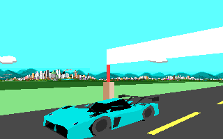
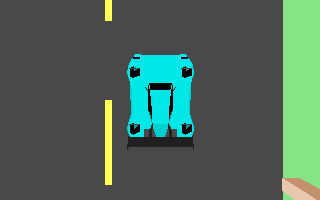

# McMurtry Spéirling PURE custom car

`MCMU` adds the **2026 production Spéirling PURE** as a new car. It includes
original bodywork, turquoise default paint and six alternatives, a digital
race cockpit, one forward gear and automatic fan adhesion. No existing car
or engine code is replaced.

Paint order: turquoise (default), purple, orange, yellow, blue, white and
light gray.

[View all seven paint jobs](cars/mcmurtry-paints.png).



[Front-fender close-up](cars/mcmurtry-fender-detail.png) ·
[Front](cars/mcmurtry-front.png) ·
[Rear](cars/mcmurtry-rear.png) ·
[Rear three-quarter](cars/mcmurtry-rearquarter.png) ·
[High-resolution view](cars/mcmurtry-hires.png) ·
[2026 specifications in the car menu](cars/mcmurtry-menu.png)



[Four vent details](cars/mcmurtry-vent-detail.png)


[Left steering](cars/mcmurtry-cockpit-left.png) ·
[Right steering](cars/mcmurtry-cockpit-right.png)

```sh
python3 tools/scripts/generate-mcmurtry-speirling.py --install stunts
python3 tools/scripts/generate-mcmurtry-speirling.py --check --install stunts
```

Select **McMurtry Speirling PURE** in the car menu. For another game-data
folder, copy `CARMCMU.RES`, `STMCMU.3SH`, `STDAMCMU.VSH` and `STDBMCMU.VSH`
from `assets/cars/` into its `cars/` subfolder. Restunts release packages include
the car automatically, and loose files in the game-data or executable folder
remain supported. Install the four files together. `tools/scripts/cars/` retains
`MCMU.json` with reference URLs, dimensions and resource hashes, and
`READMCMU.TXT` with installation instructions. `MCMU.obj` and `MCMU.mtl`
provide a portable, editable 3D source export in metres, with Y up and tyre
bottoms at ground level; keep those two files together when importing.

## Model source

An internet search found a free
[OUTPISTON Sketchfab model](https://sketchfab.com/3d-models/mcmurtry-speirling-8217dad4511a441baadffac685ba4a62)
under CC BY-NC-SA 4.0, but its official download API required authentication.
The other candidates were paid marketplace assets or extracted game models
without clear redistribution permission. None of those meshes is used.

The initial car was reconstructed from the front, side, rear and
three-quarter manufacturer renders accompanying the
[June 2023 PURE announcement](https://mcmurtry.com/the-mcmurtry-speirling-pure-a-record-breaking-track-only-fan-car-you-can-own/).
The front and rear have since been rebuilt from the manufacturer's
[2026 production photographs](https://mcmurtry.com/mcmurtry-speirling-production-form/),
including the divided nose intakes, headlight housings, sculpted rear ducts,
tail lamps and diffuser. The shell also incorporates the user's wheel-vent
detail photographs and is calibrated to the current 2026 dimensions and wheelbase.
The original geometry retains the narrow bubble cockpit, rounded nose,
separate wheel arches, recessed sides, rear fan ducts and raised wing.
Manufacturer reference images are linked in the manifest, rather than
redistributed. The editable authoring source is
[`mcmurtry_model.py`](../tools/scripts/mcmurtry_model.py).

The nose has raised outer fenders, a low centre section, inset dark headlight
lenses, divided black intakes and a carbon splitter. The rear's two duct
mouths have four-corner inner sections, closed dark backs and small painted
sidewalls. A narrow central spine and outer diffuser walls define the lower
rear, with four small red lamps and hooked wing supports above it. These
features are geometry in the showroom and both racing detail levels.

`car0` is the showroom shape; `car1` and `car2` are the racing detail levels.
Four `exp` shapes provide crash debris. All shapes use native Stunts
primitives and remain within its 255-vertex and 255-primitive limits.
The first eight car vertices are bounds; the following 24 control the four
animated wheels. The cockpit is original indexed-colour artwork based on
the supplied `1000005914.jpg`, `1000005913.jpg` and `1000005912.jpg` cockpit
photographs and the earlier
[wheel reference](https://www.topgear.com/car-reviews/speirling/first-drive).
It combines an upright LCD and unlit lamp row with a continuous shaped steering
rim: textured side grips join contrasting carbon top and bottom bridges.
All rim sections use the same rotation about the wheel hub in each steering
view, preserving the upper bridge's shape as it turns.
The five fluted knobs match and have blank interiors. The record-holder
inscription is removed and the live instrument needle is red. Turquoise vent
pods, four silver circular vents, stitched padding, carbon trim, seams,
fasteners and release hardware
add detail on both sides. Speed and motor instruments update live in all
three steering positions.

The upper carbon cowl follows a gentle curve around the wheel, with a shaded
lip instead of a straight horizontal edge. The native `dast`/`dasm` artwork
and mask pair draws this shallow crown and the raised front fenders, including
their painted rims and dark top openings. The road remains live above the
curved edge. These bitmap fenders use the
default turquoise finish in every exterior paint scheme, as with fixed-colour
bodywork in stock Stunts dashboards.

The fenders have raised inner shoulders and explicitly triangulated covers
above the tyre envelope, while the central bonnet stays low and the side
wheel arches remain open. Four recessed wheel-crown vents follow the user's
detail photographs `1000005898.jpg`, `1000005901.jpg`, `1000005899.jpg` and
`1000005900.jpg`. Each has a chamfered painted rim, dark inset bowl,
and a cross rib. This bounded low-polygon recess represents the real opening;
it is distinct from an uncontrolled tyre painting over adjacent bodywork.
The showroom and both racing models include the vents.

The native painter sorts a whole wheel at its rim centre and ordinary
polygons at their average vertex depth. A physically correct fender can
therefore paint behind its wheel in an angled view. Each wheel is now
followed by its covering roof triangles and vent details with primitive flag
`0x02`, which attaches them to the wheel's drawing order. The wheel paints
first, then its cover and bounded vent recess. Outward face culling and open
side arches are retained. The headlight lenses follow the front fender skin
in the same group so the native painter preserves their visible surfaces.

## Real specifications and scale

Specifications were checked on 21 October 2026 against
[Wikipedia](https://en.wikipedia.org/wiki/McMurtry_Sp%C3%A9irling), the
[current factory specification](https://mcmurtry.com/speirling-pure/), the
[July production announcement](https://mcmurtry.com/mcmurtry-speirling-production-form/)
and the [September debut report](https://mcmurtry.com/speirling-usa-debut/).
The production car publicly debuted at Monterey Car Week in August 2026;
first customer deliveries were announced for later in 2026.

The production specification is 1,000 bhp (745 kW), approximately 1,350 kg
depending on options, a 100 kWh battery and a 190 mph top speed. Twin motors
drive the rear wheels through a single-speed transmission and E-differential.
The claimed 0–60 mph time is **1.55 seconds with one-foot rollout**.
Michelin Pilot Sport GT S8M slicks are 30/68-18 front and 31/71-18 rear.
The factory lists 2,000 kg of downforce from standstill and 3 g cornering and
braking capability.

Wikipedia still mixes its production dimensions and battery capacity with
older 900 kg / sub-1,000 kg weight figures and a rounded 1,050 mm height.
The factory's current approximately 1,350 kg and 1,056 mm figures take
precedence. The canonical data and source reconciliation live in
[`mcmurtry_physics.py`](../tools/scripts/mcmurtry_physics.py).

A uniform **44 mm per racing-model unit** follows the stock Corvette's
4,506 mm / 103 units and the NSX's 4,405 mm / 100 units. Stock cars have
stylized proportions, so no new car can match every stock car exactly.

| Dimension | Real 2026 PURE | Racing model | Stock NSX model |
| --- | ---: | ---: | ---: |
| Length | 3,815 mm | 86 | 100 |
| Width | 1,795 mm | 40 | 40 |
| Height including tyres | 1,056 mm | 24 | 24 |
| Wheelbase | 2,200 mm | 50 | 58 |

The showroom uses the stock 20× scale and retains approximately
86.7 × 40.8 × 24 racing units. Symmetric integer rounding gives the racing
dimensions above. Both racing detail levels have identical overall size and
wheel contacts. Eight-unit tyre radii and two-unit axle height keep tyre
bottoms on the engine's `y = -6` contact plane.
The SIMD wheel coordinates, collision box and cockpit height follow the mesh.
See [the stock dimensional references](tesla-sizing.md#stock-reference-measurements)
for the Corvette and NSX sources.

## Driving and adhesion

The native drivetrain uses a single fixed ratio, an electric torque plateau
and falling high-speed torque. SIMD mass, torque and grip values are game
tuning units, rather than SI measurements. The grip value is 1,200.
Acceleration is calibrated to
the production car's 1.55-second claim with one-foot rollout. The manifest
records standing-start and rollout-adjusted game times separately.

The grounded, level-road drivetrain update was checked against native
`statecar.c` with the generated SIMD:

| Physics rate | Standing 0–60 mph | 0–60 with 1 ft rollout | 0–100 mph | Peak speed |
| --- | ---: | ---: | ---: | ---: |
| 20 Hz | 1.75 s | 1.55 s | 3.10 s | 190.22 mph |
| 10 Hz | 1.80 s | 1.60 s | 3.10 s | 190.44 mph |

The engine's redline braking produces a small speed oscillation around the
limit. These figures isolate the drivetrain with all tyres grounded; track
geometry, steering and collisions can change a full driving run.

`fand = 01` enables adhesion. `adhs = 01 0C 00 00 20 0F` explicitly selects
12 world units, a 60-degree alignment limit and paved/dirt/ice/grass surfaces.
Updated Restunts reads those settings independently for player and opponent.
The system attaches tyre contacts to supported driving surfaces, including
vertical and inverted ones, and releases when contact is lost. It is the
engine's approximation of fan downforce; it does not simulate aerodynamic
suction or permit adhesion to water. Original Stunts ignores both resources.
See [the adhesion format](car-adhesion.md). Use identical car resources for
recording and replay playback.

## Validation

The generator validates DSI directories, the 776-byte SIMD, car text,
seven model resources, polygon indices and normals, animated wheel slots,
bounding boxes, visual/physical wheel agreement, contact height and uniform
real-world scale. It also samples the encoded upper tyre envelope against
the body surface, catching the original intersection in all three detail
levels; the production-sized meshes have at least 1.07 model units of clearance.
Only triangles attached to the matching wheel count as cover, so a change
that loses the required native drawing order also fails generation.
It validates cockpit bitmaps, paired windshield masks and needle colour.
Generation requires strictly less dashboard memory than DIA3, both after
extraction and after native preparation, including instrument/gearbox scratch.
`--check` compares generated bytes with the package and optional installed
game files.

The classic 320×200 native loader and allocator give these dashboard sizes:

| Stage | MCMU | DIA3 |
| --- | ---: | ---: |
| Extracted STDA + STDB | 83,907 bytes | 148,036 bytes |
| Prepared STDA + STDB in the arena | 36,576 bytes | 66,176 bytes |
| Shared instrument/gearbox scratch bitmap | 2,576 bytes | 14,128 bytes |
| Resident arena total including scratch | **39,152 bytes** | **80,304 bytes** |

The prepared and scratch sizes include the native 16-byte allocation rounding.
Both dashboards share their instrument and gearbox scratch bitmap: MCMU uses
88×29 pixels, while DIA3 uses 188×75. Sprite definitions and row tables occupy
the common preallocated window table. MCMU therefore uses about 43% less
extracted resource memory and 51% less resident dashboard arena memory.
The same sizes and strict limits are recorded in `MCMU.json` and `READMCMU.TXT`.

The native renderer and resource loader are also exercised with a temporary
replay selecting `MCMU`, including a two-car setup that checks adhesion for
both slots. The actual car menu renders the nine-row user-supplied
description within its panel at classic and high resolutions.
Overhead and elevated views check fender occlusion, and moving
cockpit captures check live instruments and steering redraws. These checks
use isolated game data and leave saved games intact.

The angled wheel-occlusion regression also disables only wheel rasterization,
preserving the native queue, depth sorting and attached cover polygons. In
front, rear and overhead views, wheel-colour diagnostics distinguish tyre
pixels from painted bodywork and confirm that normal near-side tyres remain
visible.
Far-wheel checks cover both racing detail levels and the actual showroom
at classic and high resolutions. They require zero tyre drawing over the
painted bodywork; overhead views also require zero wheel rasterization.
Near-wheel controls confirm that visible tyres are drawn. Material isolation
distinguishes the near tyre covering bodywork seen through its open side
arch from a tyre drawing over its own fender skin.
The four intentional vent recesses remain unchanged when wheel rasterization
is disabled, distinguishing their modeled black interiors and cross ribs
from unintended tyre drawing through the surrounding fenders.
