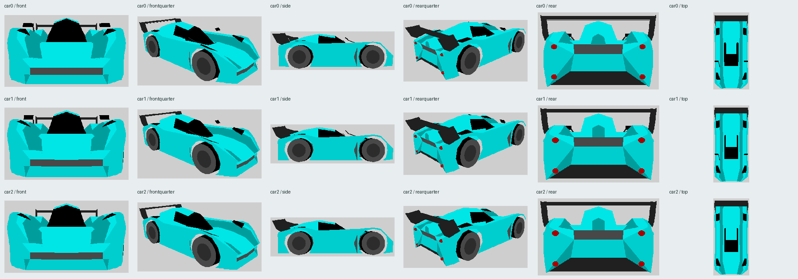
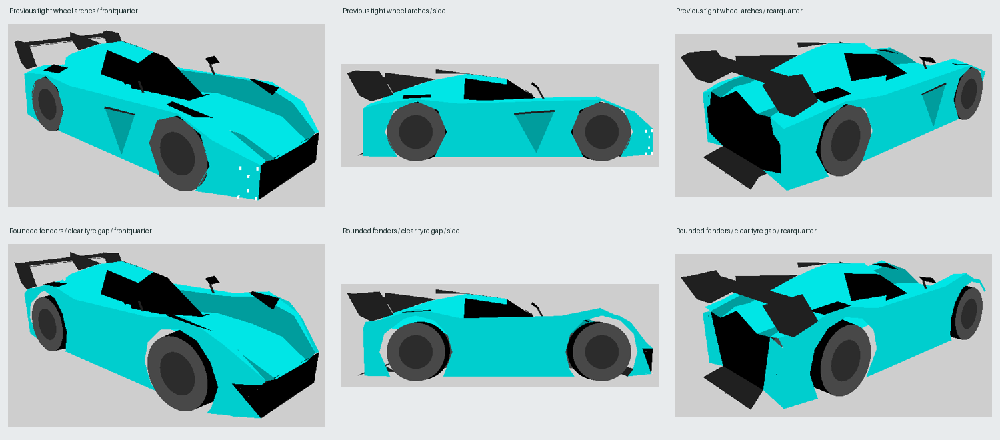
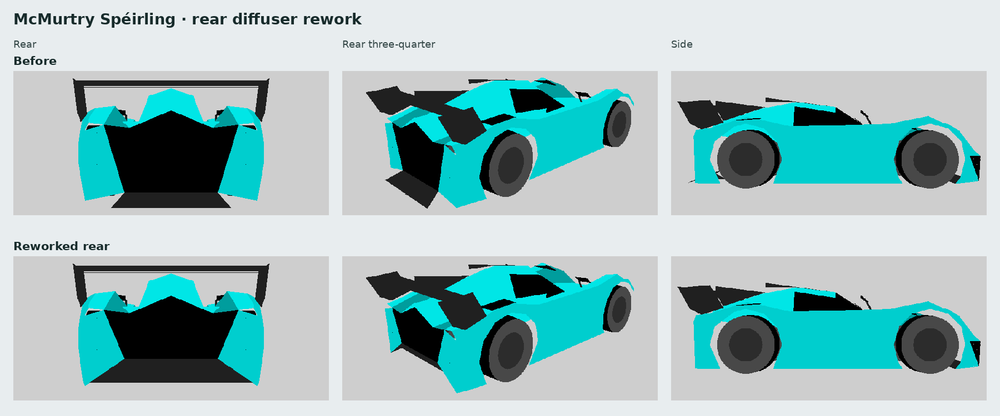
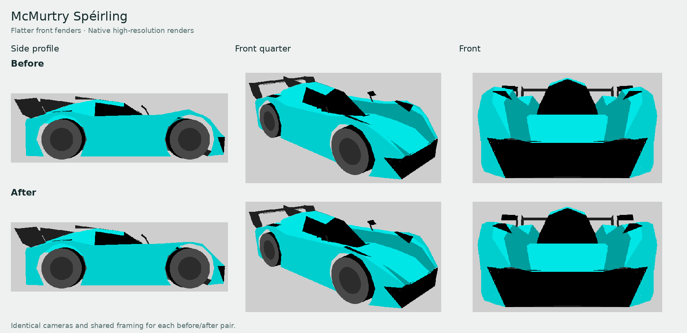
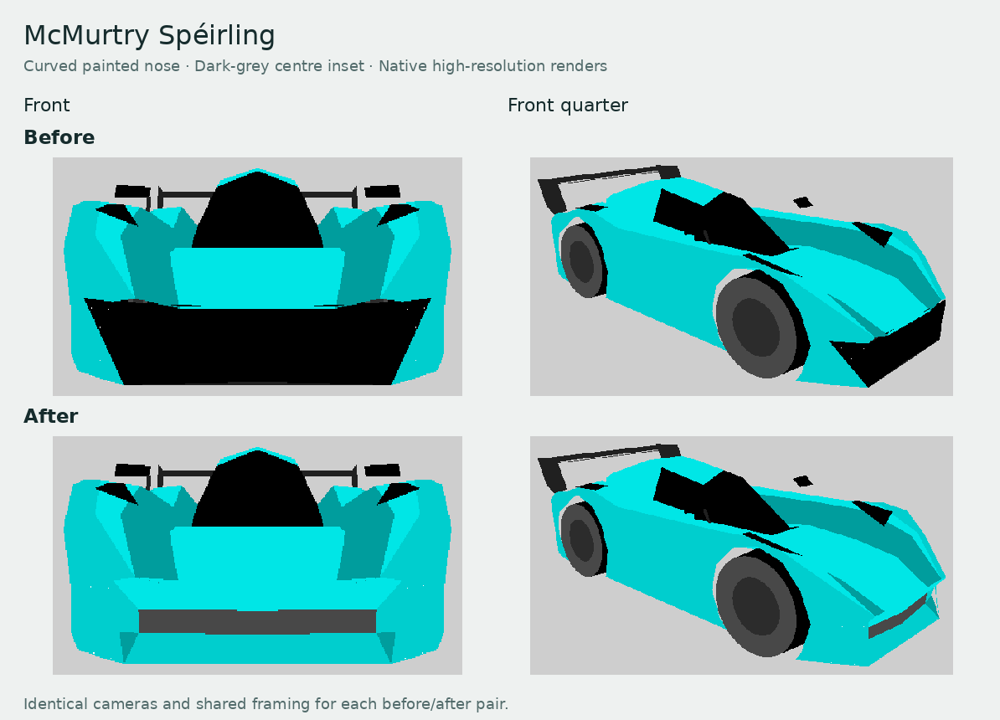
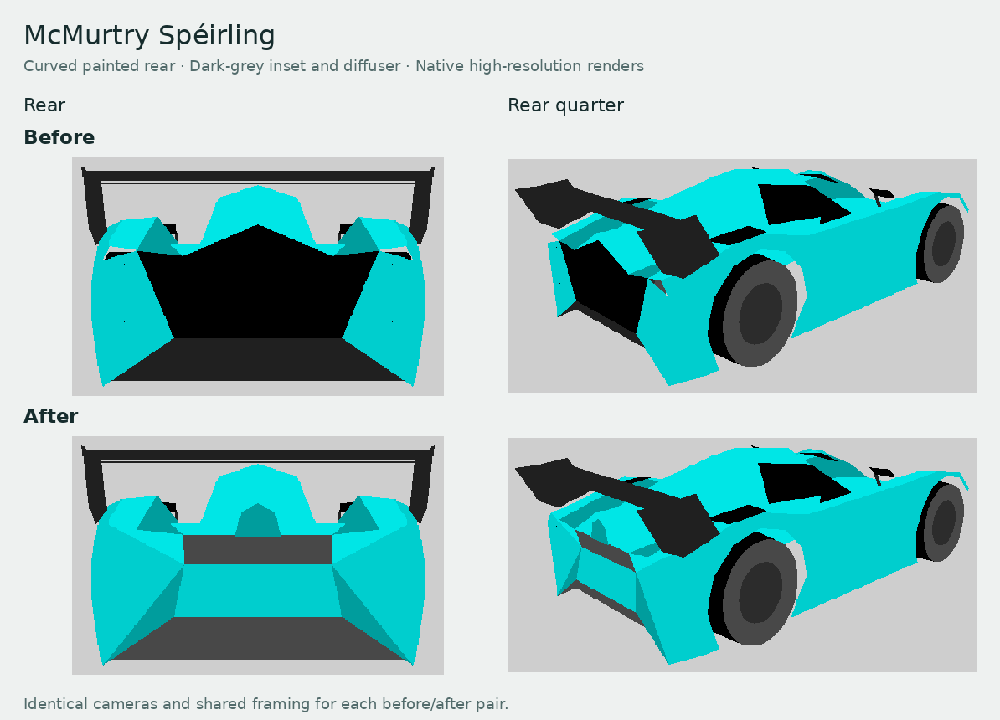
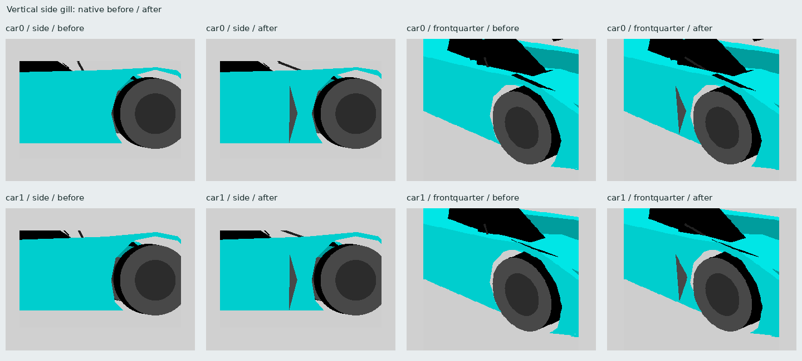
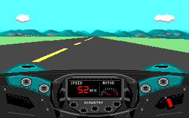

# McMurtry Spéirling PURE custom car

`MCMU` adds a **McMurtry Spéirling** custom car with entirely rebuilt
low-polygon bodywork, turquoise default paint and six alternatives, a digital
race cockpit, one forward gear and automatic fan adhesion. Its exterior
follows the supplied high-resolution model with rounded, enlarged wheel
areas; its driving specification retains
the 2026 production PURE figures described below. No existing car or engine
code is replaced.

Paint order: turquoise (default), purple, orange, yellow, blue, white and
light gray.

[View all seven paint jobs](cars/mcmurtry-paints.png).















[2026 specifications in the car menu](cars/mcmurtry-menu.png)



[Left steering](cars/mcmurtry-cockpit-left.png) ·
[Right steering](cars/mcmurtry-cockpit-right.png)

```sh
python3 tools/scripts/generate-mcmurtry-speirling.py --install stunts
python3 tools/scripts/generate-mcmurtry-speirling.py --check --install stunts
```

Select **McMurtry Speirling PURE** in the car menu. For another game-data
folder, copy `CARMCMU.RES`, `STMCMU.3SH`, `STDAMCMU.VSH` and `STDBMCMU.VSH`
from `assets/cars/` into its `cars/` subfolder. Restunts release packages include
the car automatically, and loose files in the game-data or executable folder
remain supported. Install the four files together. `tools/scripts/cars/` retains
`MCMU.json` with reference URLs, dimensions and resource hashes, and
`READMCMU.TXT` with installation instructions. `MCMU.obj` and `MCMU.mtl`
provide a portable, editable 3D source export in metres, with Y up and tyre
bottoms at ground level; keep those two files together when importing.

## Model source

The exterior was rebuilt from scratch as native low-polygon topology, guided
by the user-supplied `2026-mcmurtry-speirling.zip` GLB. The source is
[2026 McMurtry Spéirling](https://sketchfab.com/3d-models/2026-mcmurtry-speirling-24a39a15bde049acbb3ede571cee0c8b)
by [Dave Love SketchFab](https://sketchfab.com/Tyler_Dave), identified in its
embedded `asset.extras` metadata as
[CC BY 4.0](http://creativecommons.org/licenses/by/4.0/). The manifest records
that attribution and the supplied GLB's SHA-256 hash. The source contains
211,145 triangles, 110 meshes and 43 materials; its original high-polygon
GLB and textures are not included in this package.

Although the download is titled 2026, its hierarchy names
`exmods_mcmurtry_speirling22.fbx`, suggesting an earlier prototype. The supplied
high-resolution mesh establishes the exterior reference. The adaptation
replaces all exterior topology in the showroom and both racing detail levels.
The nose, canopy, side recesses, rear bodywork, roof, main rear wing and
wheel locations follow the source mesh. The thin centre fin above the canopy
and rear cowl is omitted for a clean roof silhouette. A subsequent wheel-area
refinement prioritizes rounded fenders and a visible tyre gap. The accepted
canopy surface and animated wheel controls remain unchanged. Mirror heads
retain their shape, with stems attached to existing fender-crown vertices to
reserve geometry for the side gills. The front fender crown follows the
source's shallow, nearly level profile toward the cockpit, with a small lift over the enlarged native arch instead of a tall
peak over the axle.
The nose has curved body-colour bands above and below a narrow dark-grey
inset, rolled painted cheeks and a low splitter. The four white front lamp
markers are omitted. Four shared rows of five points form the front
curvature, with triangles joining the bands and side caps. The inset
uses native grey material 19 (RGB 72, 72, 72), keeping the remaining intake
visible without a broad black opening. The front cap and lower rim share
seams with the hood and undertray, including at racing precision.
Each side has a single tall, narrow, tapered gill behind the front wheel.
The user-supplied `detail.png` guides its vertical shape; the opening faces
rearward as requested. Its recessed dark-grey triangular wall is visible
from behind, while body-colour skin covers it from front-quarter views.
The centre pulls 1.5 game units inward to give the recess depth, while the
surrounding side panels share the existing wheel-arch edges. Three added
vertices per side form this detail without changing the tyre clearance.
The wing has two elements and large swept endplates. Native animated wheels
use integer controls, and seven paint schemes use native materials.
The rear fascia has painted shoulders that roll down from the complete
rear roof cross-section, and a painted lower bumper around a compact
dark-grey inset. Its lower edge sits one game unit inward, giving the
inset a shallow recess. It uses the same grey material 19 as the front
instead of a broad black panel. Four small round red brake lamps form an
upper and lower pair at each rear corner, placed from the three rear
photographs supplied by the user. The upper lenses are approximately
89–98 mm across after native quantization; the lower lenses are about 88 mm.
Native round primitives simplify them to solid red circles, with brake
material 45 preserving their brighter appearance under braking. Their
upper diameter controls reuse existing fender-crown vertices to fit the
native vertex limit. The canopy rear cap and main wing retain their geometry.
The rear undertray rises into the lower fascia,
with shared seams joining its centre ramp and side panels to the body. It
ends flush with the rear body instead of extending downward beneath the wing.
The exposed diffuser ramp and corner returns use the same darker grey
carbon material 39 as the underbody. The upper rear inset retains grey
material 19. The main floor stays inside the tyres and widens behind the
rear arches.

The manifest retains earlier exterior photo URLs as historical references.
The editable authoring source is
[`mcmurtry_model.py`](../tools/scripts/mcmurtry_model.py), with measured GLB
cross-sections, wheel centres and part bounds in
[`mcmurtry_source_profile.json`](../tools/scripts/mcmurtry_source_profile.json).
The reference GLB is not required for deterministic regeneration.
`MCMU.obj` and `MCMU.mtl`
export the adapted low-polygon geometry, with 16-sided discs for the rear
lamp lenses. See
[`THIRD-PARTY-NOTICES.txt`](../THIRD-PARTY-NOTICES.txt) for its attribution
and modification notice.

`car0` is the showroom shape; `car1` and `car2` are the racing detail levels.
Four new `exp` shapes use panels from the rebuilt fender, door, glass and
wing as crash debris. All shapes use native Stunts
primitives and remain within its 255-vertex and 255-primitive limits.

| Shape | Vertices | Primitives |
| --- | ---: | ---: |
| `car0` showroom | 255 | 246 |
| `car1` racing | 255 | 245 |
| `car2` distant racing | 247 | 241 |

The first eight car vertices are bounds; the following 24 control the four
animated wheels. The cockpit is original indexed-colour artwork based on
the supplied `1000005914.jpg`, `1000005913.jpg` and `1000005912.jpg` cockpit
photographs and the earlier
[wheel reference](https://www.topgear.com/car-reviews/speirling/first-drive).
It combines an upright LCD and unlit lamp row with a continuous shaped steering
rim: textured side grips join contrasting carbon top and bottom bridges.
All rim sections use the same rotation about the wheel hub in each steering
view, preserving the upper bridge's shape as it turns.
The five fluted knobs match and have blank interiors. The record-holder
inscription is removed and the live instrument needle is red. Turquoise vent
pods, four silver circular vents, stitched padding, carbon trim, seams,
fasteners and release hardware
add detail on both sides. Speed and motor instruments update live in all
three steering positions.
A native steering dot slides along a horizontal strip above the shaped wheel,
as on the Pontiac Firebird, showing the steering angle between wheel poses.

The upper carbon cowl follows a gentle curve around the wheel, with a shaded
lip instead of a straight horizontal edge. The native `dast`/`dasm` artwork
and mask pair draws this shallow crown and the raised front fenders, including
their painted rims and dark top openings. The road remains live above the
curved edge. These bitmap fenders use the
default turquoise finish in every exterior paint scheme, as with fixed-colour
bodywork in stock Stunts dashboards.

The fender crowns use four points across each side to round the shoulders.
Side arch openings follow a ten-unit circle in 30-degree steps around the
eight-unit tyres. The larger openings preserve a visible gap after native
integer rounding, including the projected front-wheel steering envelope.
Four source-derived wheel-crown openings use bounded dark quadrilateral
surfaces within the fenders. Their native attachment to each animated wheel
preserves the drawing order in angled views.

The native painter sorts a whole wheel at its rim centre and ordinary
polygons at their average vertex depth. A physically correct fender can
therefore paint behind its wheel in an angled view. Each wheel is now
followed by its covering fender faces with primitive flag `0x02`, which
attaches them to the wheel's drawing order. The wheel paints first, then
its cover. Outward face culling and open side arches are retained.

## Real specifications and scale

Specifications were checked on 21 October 2026 against
[Wikipedia](https://en.wikipedia.org/wiki/McMurtry_Sp%C3%A9irling), the
[current factory specification](https://mcmurtry.com/speirling-pure/), the
[July production announcement](https://mcmurtry.com/mcmurtry-speirling-production-form/)
and the [September debut report](https://mcmurtry.com/speirling-usa-debut/).
The production car publicly debuted at Monterey Car Week in August 2026;
first customer deliveries were announced for later in 2026.

The production specification is 1,000 bhp (745 kW), approximately 1,350 kg
depending on options, a 100 kWh battery and a 190 mph top speed. Twin motors
drive the rear wheels through a single-speed transmission and E-differential.
The claimed 0–60 mph time is **1.55 seconds with one-foot rollout**.
Michelin Pilot Sport GT S8M slicks are 30/68-18 front and 31/71-18 rear.
The factory lists 2,000 kg of downforce from standstill and 3 g cornering and
braking capability.

Wikipedia still mixes its production dimensions and battery capacity with
older 900 kg / sub-1,000 kg weight figures and a rounded 1,050 mm height.
The factory's current approximately 1,350 kg and 1,056 mm figures take
precedence. The canonical data and source reconciliation live in
[`mcmurtry_physics.py`](../tools/scripts/mcmurtry_physics.py).

A uniform **44 mm per racing-model unit** follows the stock Corvette's
4,506 mm / 103 units and the NSX's 4,405 mm / 100 units. Stock cars have
stylized proportions, so no new car can match every stock car exactly.

The downloaded mesh is uniformly scaled to the nominal 3,815 mm car length
at that scale. Its width and height preserve the source aspect ratio; they
are not adjusted to the production specification. The unrounded visual
envelope is approximately 86.7 × 38.8 × 27.3 game units (length × width ×
height). The rounded wheel areas deliberately adapt that reference. The
showroom uses the stock 20× scale, and both racing detail levels share the
same overall size and wheel controls.

Wheel locations follow the source mesh with integer quantization for native
animated wheels: front centres are `(±16, 2, 27)` and rear centres are
`(±16, 2, -24)`, with eight-unit radii and three-unit half-widths. Tyre bottoms
meet the engine's `y = -6` contact plane. The SIMD wheel coordinates,
collision box and cockpit height follow the rebuilt geometry.
See [the stock dimensional references](tesla-sizing.md#stock-reference-measurements)
for the Corvette and NSX sources.

## Driving and adhesion

The native drivetrain uses a single fixed ratio, an electric torque plateau
and falling high-speed torque. SIMD mass, torque and grip values are game
tuning units, rather than SI measurements. The grip value is 1,200.
Acceleration is calibrated to
the production car's 1.55-second claim with one-foot rollout. The manifest
records standing-start and rollout-adjusted game times separately.

The grounded, level-road drivetrain update was checked against native
`statecar.c` with the generated SIMD:

| Physics rate | Standing 0–60 mph | 0–60 with 1 ft rollout | 0–100 mph | Peak speed |
| --- | ---: | ---: | ---: | ---: |
| 20 Hz | 1.75 s | 1.55 s | 3.10 s | 190.22 mph |
| 10 Hz | 1.80 s | 1.60 s | 3.10 s | 190.44 mph |

The engine's redline braking produces a small speed oscillation around the
limit. These figures isolate the drivetrain with all tyres grounded; track
geometry, steering and collisions can change a full driving run.

`fand = 01` enables adhesion. `adhs = 01 0C 00 00 20 0F` explicitly selects
12 world units, a 60-degree alignment limit and paved/dirt/ice/grass surfaces.
Updated Restunts reads those settings independently for player and opponent.
The system attaches tyre contacts to supported driving surfaces, including
vertical and inverted ones, and releases when contact is lost. It is the
engine's approximation of fan downforce; it does not simulate aerodynamic
suction or permit adhesion to water. Original Stunts ignores both resources.
See [the adhesion format](car-adhesion.md). Use identical car resources for
recording and replay playback.

## Validation

The generator validates DSI directories, the 776-byte SIMD, car text,
seven model resources, polygon indices and normals, animated wheel slots,
bounding boxes, visual/physical wheel agreement, contact height and uniform
source scaling. Visible height follows the canopy ridge after removing the
centre fin; the original source bounds remain recorded separately.
It samples the encoded upper tyre envelope against the body surface and measures the actual side-facing triangles around each outer
tyre face. This catches arch chords or filled openings that intersect a tyre
after integer rounding, even when the roof clears it. Front-wheel checks
include a conservative projected envelope for the full steering range.
Every encoded outer arch must leave at least **one game unit (44 mm)** of
gap. Current minimum clearances, in game units, are:

| Shape | Front arches | Rear arches | Upper cover |
| --- | ---: | ---: | ---: |
| `car0` showroom | 1.108 | 1.317 | 1.510 |
| `car1` / `car2` racing | 1.262 | 1.191 | 1.408 |

The lower front crown retains the same side-arch gaps and more than one
game unit of upper tyre clearance after native integer rounding.
The arch minima apply to both wheels on each axle. Only triangles attached
to the matching wheel count as upper cover, so a change that loses the
required native drawing order also fails generation.
It validates cockpit bitmaps, paired windshield masks and needle colour.
Generation requires strictly less dashboard memory than DIA3, both after
extraction and after native preparation, including instrument/gearbox scratch.
`--check` compares generated bytes with the package and optional installed
game files. Run `python3 tools/scripts/test-mcmurtry-wheel-clearance.py` for
focused regressions covering crossed arch chords, filled openings, inner
channel faces, steering envelopes and both coordinate scales.

The classic 320×200 native loader and allocator give these dashboard sizes:

| Stage | MCMU | DIA3 |
| --- | ---: | ---: |
| Extracted STDA + STDB | 83,999 bytes | 148,036 bytes |
| Prepared STDA + STDB in the arena | 36,832 bytes | 66,176 bytes |
| Shared instrument/gearbox scratch bitmap | 2,576 bytes | 14,128 bytes |
| Resident arena total including scratch | **39,408 bytes** | **80,304 bytes** |

The prepared and scratch sizes include the native 16-byte allocation rounding.
Both dashboards share their instrument and gearbox scratch bitmap: MCMU uses
88×29 pixels, while DIA3 uses 188×75. Sprite definitions and row tables occupy
the common preallocated window table. MCMU therefore uses about 43% less
extracted resource memory and 51% less resident dashboard arena memory.
The same sizes and strict limits are recorded in `MCMU.json` and `READMCMU.TXT`.

The exterior contact sheet renders the encoded showroom and both racing
models through the native renderer from six views. The wheel comparison uses
matching angles for the earlier boxier wheel areas and the refined rounded
fenders and arches. The rear comparison shows the removed hanging panel and
its replacement with a connected rising undertray from matching angles.
The front-profile comparison records the earlier lower, flatter crown
correction from matching side, front-quarter and front cameras. The nose
comparison shows the broad black opening replaced with curved painted panels
and a narrow dark-grey inset. The tail comparison shows the broad black
rear fascia replaced with rolled painted shoulders, a lower painted bumper
and a compact recessed grey inset. It retains the lighter grey diffuser
surfaces from that earlier revision. The historical side-detail comparison
shows the earlier plain side panels and the original forward-facing upright
gills from matching side and front-quarter cameras for the showroom and
racing models. The current exterior and paint previews include the revised
ends and rear-facing side gills, with the lower rear matching the darker grey
underbody, the white front lamp markers removed and four round rear brake
lamps in vertical pairs. The other comparison sheets retain their earlier
stages, including any front markers or the earlier two rear point markers.
These deterministic captures make the visible tyre gap, source-shaped
silhouette, painted nose and rear curvature, upright side gills, clean canopy,
two-element wing, swept endplates, round rear lamps and dark crown slots
reviewable.

Existing cockpit and menu captures document the digital instruments,
steering positions and nine-row car description. The retained driving
validation uses a temporary `MCMU` replay, including a two-car setup that
checks adhesion for both slots. These checks use isolated game data and
leave saved games intact.
